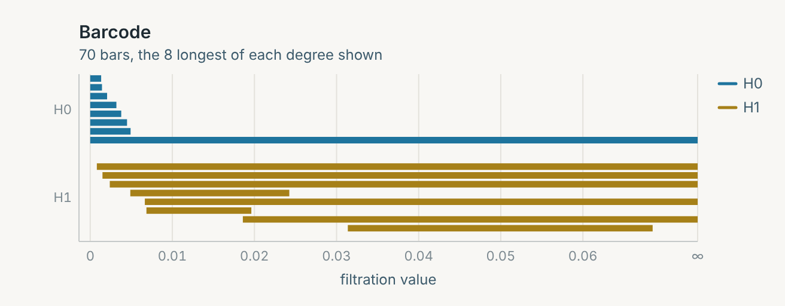
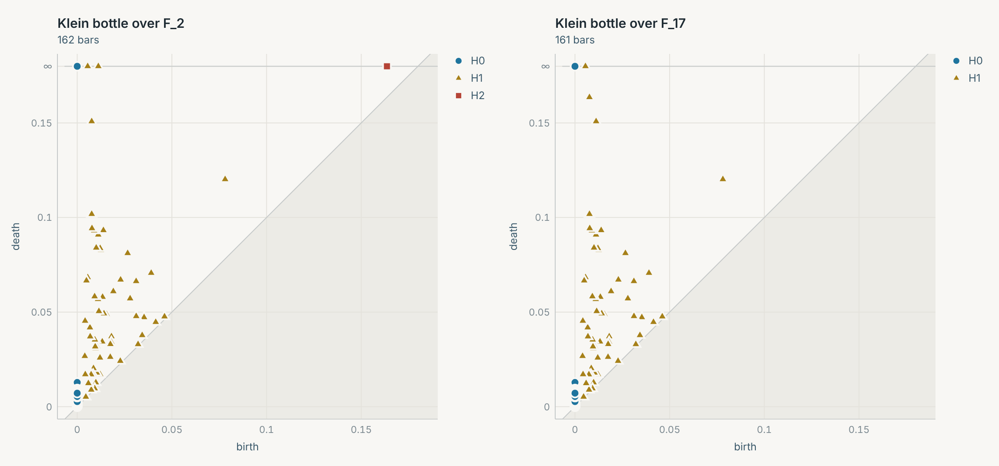
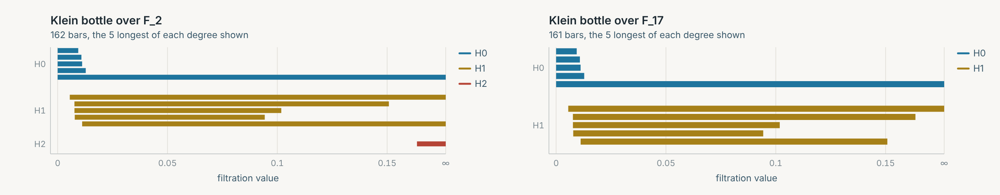
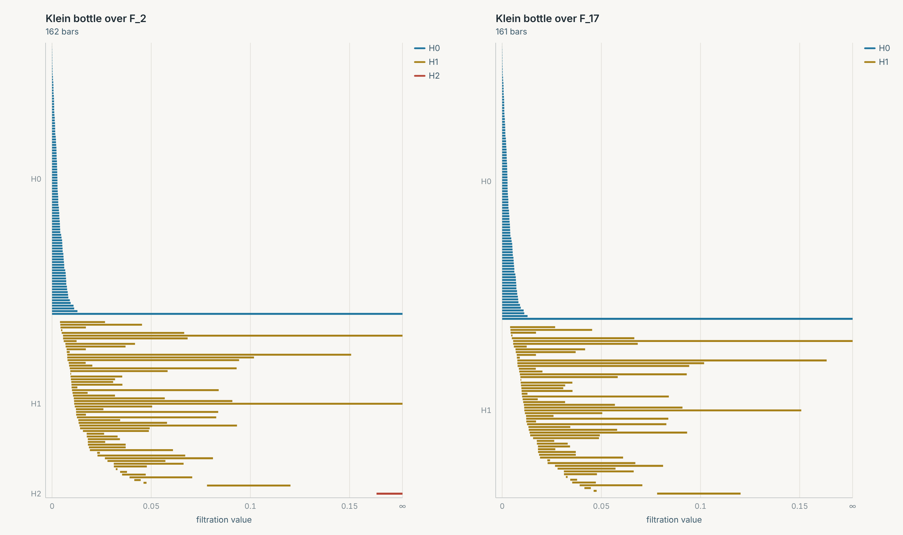

# Tutorial deck 2026-10-16: edit guide for the demo jar and the image-patches finale

Written 2026-10-16 for `_assets/presentations/tutorial-2026-10-16/`. **Nothing here edits your slides**: every change is yours to make, and the one-paste blocks below are text I built into a *copy* of the deck and rendered, never into your file. The only files added to the repository are this one and four figures in `figures-tutorial-2026-10-16/`.
Point-in-time record, like the other worklogs. "Verified" means I ran it that day, on the build described in Appendix A, and I give the output; Appendix B lists what I could not verify.

## 0. The short version

**What is wrong with the deck today**

1. **Slides 6-7 install Scala and load `:dep org.appliedtopology::tda4j:0.6.0`.** The 0.6.0 viewer is the JDK-server one that crashed on your machine (`WORKLOG-demo-jar.md`), so the deck's plot slide would hit it on that version. Slide 7 also still says the command "has added flags to pull the TDA4j library from Maven in the snapshot version" above a bare `scala repl`.
2. **Slides 8-10 are correct code.** I ran them verbatim through the demo's REPL driver: `longbars.bars(1)` *is* the H₁ loop and the cycle plot works. Cosmetic only: slide 10 has no heading and Marp shrinks its code font (the long `Plot.cycle` line); `longbars.bars(1).representative` echoes a ~1000-character line.
3. **The deck stops after the circle.** The finale (slides 12-21) and four backup slides are in the one-paste block of section 4.

**Three facts to carry into the room**

1. **The 50 000-patch sample shows the circle and the three-circle model, and it does not show a Klein bottle.** Verified: Betti numbers (1, 5, 0). The Klein bottle in the demo is the *paper's ideal one*, synthetic. This is the finding of the earlier session (`WORKLOG-klein-bottle-patches.md` section 4: the paper needed about 4 x 10⁶ patches), not a defect in the demo. The tested slides say so in plain words; if you present it as "the Klein bottle in natural images", someone in a topology seminar will ask.
2. **`:load patches.scala` echoes every `val`, 20 lines each, one coordinate per line**: 159 lines in all, 109 of them bare numbers or brackets, and the two result lines come out *first* and then scroll away behind them. The README's sample output omits this. `:silent` toggles echo off, `println` still prints. Verified. All live scripts below use it.
3. **The data file is in no repo of ours.** `n50000Dct.csv` does not exist anywhere until someone converts `n50000Dct.mat` from `appliedtopology/javaplex`. Steps and a checksum: section 2.

**Decisions only you can make**

| decision | recommendation |
|---|---|
| How participants get the jar | Rename it **`tda4j-demo.jar`** when you hand it out; then no slide mentions a version. Fill `<URL>` on slide 6 (or hand out USB sticks: 74 MB over venue wifi is the risk). |
| Whether participants get the CSV | It is 8.3 MB. If not, part 1 of the finale is presenter-driven and everyone follows part 2 (the Klein bottle needs no data file). |
| Witness complex or plain Rips for part 1 | The tested tail uses the witness complex (paper and JavaPlex route). Plain Rips on 400 landmarks also gives five loops through the one-call verb the audience just learned (backup slide, verified); pick one for the main line. |

**How long it takes (tiers; stop whenever time runs out)**

| tier | what | time |
|---|---|---|
| 0 | consistency with the jar: slide 5 bullets, replace 6-8 | ~20 min |
| 1 | polish: split slide 10 and give it a heading, `.show` line, two math tweaks | ~15 min |
| 2 | the finale: paste the tail, prepare the three files, one full rehearsal | ~45 min |
| 3 | backup slides and speaker notes (the backups are already in the block) | optional |
| - | rebuild `index.html`, push, wait for the site (about 2 min), look at the URL | ~10 min |

If you have 15 minutes: do tier 0 only. If you have 30: tier 0 plus slides 12, 13, 16, 17, 18 and 20 of the tail (drop 14, 15 and 19 and run those steps from the section 5 script).

## 1. What the slides depend on

- **Code verified against:** `scala` HEAD `abb8688c`, which has the same content as `claude/release-prep-bugs-rkjpln` (its tip `7fb51525` is what PR #90 merged). `mikael` (4 commits not on `scala`, 18 behind) was not used. Your laptop's 0.6.2, "which tracks `scala` head in content" by your note, I could not test; I tested the source it should match.
- **No jar asset exists.** The `v0.6.1` release run failed at its "tag must be reachable from `scala`" guard, so no GitHub release was created; that tag also predates `demo/`, so even a successful run would not have attached a jar. `v0.6.1`/`v0.6.2` are on Maven by your note and have no GitHub release. The deck should not depend on that being fixed: rename the jar (above).
- **Maven from my side:** this container got HTTP 404 (twice) for the 0.6.1 POM and 429 (rate limit, no information) for 0.6.0 and 0.6.2, and a build of the demo against 0.6.2 died on 429s. So **I could not confirm that `:dep org.appliedtopology::tda4j:0.6.2` resolves.** Test it on a clean network before putting it on a slide as a fallback.
- **The site updates only from `scala`:** `docs.yml` runs on push to `scala` and takes about 2 minutes (six recent runs: 1m46s to 2m37s). `_assets/presentations/` is copied as is: `gh-pages` already has `presentations/tutorial-2026-10-16/index.html` and `index.md`.
- **Marp:** your committed `index.html` is exactly `npx @marp-team/marp-cli@4.5.1 index.md -o index.html` with default options (I rebuilt it: byte-identical except the locale-derived `lang="en-US"`). Your `*` bullets on slides 2-4 are click-by-click builds; the `-` bullets on slide 5 appear at once.

## 2. Morning checklist (in this order)

**A. The jar (pick one; ~5-15 min)**

```shell
# A1. someone already built one: just rename the copy you hand out
cp tda4j-demo-<whatever>.jar tda4j-demo.jar

# A2. build it against the published library (no root build; needs demo/ from the `scala` checkout)
cd demo && TDA4J_VERSION=0.6.2 sbt assembly
#   -> demo/target/out/jvm/scala-3.9.0/tda4j-demo/tda4j-demo-0.6.2.jar   (about 74 MB)

# A3. build it from this checkout's own sources (run from demo/; the version comes from ../version.sbt)
(cd .. && sbt publishLocal) && sbt assembly
#   -> .../tda4j-demo-0.6.1-SNAPSHOT.jar
```

A2 and A3 are `demo/README.md`'s own recipes; I could not run them here (Maven Central rate-limited this container), the earlier session built the jar. **Smoke test any jar in 10 seconds** (same check as `release.yml`):

```
java -jar tda4j-demo.jar
scala> val d = Persistence(Seq(Seq(0.0, 0.0), Seq(1.0, 0.0), Seq(1.0, 1.0), Seq(0.0, 1.0)))
val d: PersistenceDiagram[Simplex[Int]] = PersistenceDiagram(5 bars, degrees 0..2)
  H0: 4 bars, longest [0.000, Infinity) [0.000, 1.000) [0.000, 1.000) [0.000, 1.000)
  H1: 1 bar, longest [1.000, 1.414)
```

**B. The data (~5 min; verified)**

```shell
git clone --depth 1 https://github.com/appliedtopology/javaplex     # 119 MB; or fetch just data/natural_images/n50000Dct.mat (3.07 MB)
python3 -m venv venv && venv/bin/pip install scipy numpy             # Windows: py -m venv venv, venv\Scripts\pip ...
venv/bin/python mat2csv.py javaplex/data/natural_images/n50000Dct.mat n50000Dct.csv
```

`mat2csv.py` (the part of `demo/examples/patches/experiments/convert.py` the tutorial needs, without its 120 MB k-NN table):

```python
"""Minimal .mat -> .csv for the natural-image patch files (what demo/examples/patches/experiments/convert.py does, without the k-NN table).
usage: python -I mat2csv.py <name.mat> <out.csv>"""
import sys
import numpy as np
import scipy.io

src, out = sys.argv[1], sys.argv[2]
m = scipy.io.loadmat(src)
(key,) = [k for k in m if not k.startswith("__")]       # one variable per file
a = np.asarray(m[key], dtype=np.float64)
np.savetxt(out, a, delimiter=",", fmt="%.17g")           # %.17g round-trips a double exactly
norms = np.linalg.norm(a, axis=1)
print(f"{src.split('/')[-1]}: variable '{key}', shape {a.shape}, row norms in [{norms.min():.12f}, {norms.max():.12f}]")
```

Check the result against mine: 50 000 lines, 8 278 750 bytes, first line `-0.40241218624574576,0.74126392261733631,0.28601071696305091,0.069345433983208388,-0.27868703215777368,-0.23886992030402993,0.22025022239681585,-0.13691547796974163`, SHA-256 `f309c43fe3d668e1846abda5c22658837d5e5fb50a5f852bf01f038934b85e13` (numpy `savetxt` and pandas `to_csv` give the identical file). The `.mat` is 3 068 427 bytes, MD5 `eede83d3a052c46a0ecd32b60df9d62f`. Every row has norm 1 to within 1e-7 (the script prints the range). The readme next to the data names its sources (Lee-Pedersen-Mumford sample of van Hateren's images); `demo/examples/patches/README.md` says to check their terms before copying the data anywhere, so decide that before the CSV goes on a USB stick.

**C. The bundle** (one folder, one zip, one USB stick): `tda4j-demo.jar`, `n50000Dct.csv`, `klein.scala` (section 5), `mat2csv.py`. Start the REPL **from that folder**: `load("n50000Dct.csv")` and `:load klein.scala` are relative paths.

**D. One full rehearsal (~10 min):** `java -Xmx2g -jar tda4j-demo.jar`, then the warm-up and the finale lines of section 5 on the projector resolution, with the terminal on one half of the screen and the browser on the other (every `view()` adds to one browser page). Run the three `.save` lines at the end of section 5 to produce backup figures.

**E. Edit slides** (section 3 and 4), then rebuild and publish:

```shell
cd _assets/presentations/tutorial-2026-10-16
npx @marp-team/marp-cli@4.5.1 index.md -o index.html     # commit BOTH files; the site serves index.html
git add index.md index.html && git commit -m "Tutorial deck: demo jar and the image-patches finale"
git push origin scala                                      # docs.yml republishes in about 2 minutes
```

then open `https://tda4j.appliedtopology.org/presentations/tutorial-2026-10-16/` and page through it once. The commit has to land on `scala` (push to it, or open a pull request and merge it; every recent commit there is a merged PR, so check whether pushing directly is allowed): a push to any other branch publishes nothing. If you present from the local `index.html` offline, the three logo images (they load from `tda4j.appliedtopology.org`) will be missing; nothing else is.

## 3. Slide by slide

| now | slide | action | why |
|---|---|---|---|
| 1 | Title | keep; optional: add a line `Demo jar: <URL>` | participants can start the 74 MB download while you talk |
| 2 | What are we even doing? | keep | |
| 3 | What are we even doing? | keep; optional: the `\ker`/`\operatorname{im}` form below | `$kernel / image$` typesets as italic letters; **the slide is full to the bottom edge, add no text** |
| 4 | What are we even doing? | change one bullet | "Hierarchical clustering == H₀" is true for *single-linkage* only |
| 5 | Plan for today | rewrite the bullets | still says "Install Scala and TDA4j" |
| 6 | Install Scala | **replace** with "Get Java and the demo jar" | sdkman and Scala are no longer needed; Java 17+ is |
| 7 | Open a Scala prompt... | **replace** with "Start the demo" | `:dep ...:0.6.0` loads the crashing viewer; the sentence about flags is stale |
| 8 | Load the library | **replace** with "What the jar did for you" | the four imports are pre-run (`DemoRepl`); `cats.syntax.show.*` is the one your slides never mentioned |
| 9 | Compute persistent homology | keep the code; add one sentence; `.show` on the last line | see below |
| 10 | (no heading) plots | split into "Look at it" and "The cycle itself", add headings | the long `Plot.cycle` line shrinks the whole code block |
| - | 12-21 | **new** finale | section 4 |
| - | 22-25 | **new** backups | torus control, plain Rips, own project, data source |

Why slide 9 changes: `Persistence(points)` returns **56 bars** for your circle: 50 in H₀, one in H₁ (`[12.56, 175.3)`), and five H₂ bars of length ~3e-14 (consistent with floating-point ties on a perfectly regular 50-gon; they survive the exact-zero filter). `significant(0.10)` keeps bars longer than 10% of the point cloud's **enclosing radius**, which is 200 here (`minimumEnclosingRadius` = 199.99999999999997), so the 49 finite H₀ bars of length 12.56 and the five dust bars go: two bars remain, `longbars.bars(1)` is the loop. Say that sentence aloud, someone will ask "10% of what?". And `println(...representative.show)` prints the readable `Fp(1) ⊠ ∆(0,1) + Fp(-1) ⊠ ∆(0,49) + ...` (the REPL's own echo is `1⊠TreeSet(0, 1) + ...`); it is a 978-character line, a talking point ("the loop as a sum of 50 edges, coefficients mod 17") rather than something to read.

Two small edits to slides 3-4 (line numbers refer to the current `index.md`):

```markdown
<!-- line 72 -->
* The quotient vectorspace $H_d(X) = \ker \partial_d \,/\, \operatorname{im} \partial_{d+1}$ captures significant generalized loops.

<!-- line 83 -->
* Single-linkage hierarchical clustering == the $H_0$ barcode of the data.
```

(I rendered both; MathJax handles them. Slide 3 already wraps to the bottom edge; the replacement is about as long.)

## 4. The one-paste block (slides 5 to the end, plus backups)

In `index.md`, **replace everything from line 87 (`# What are we even doing?`, the one followed by `Plan for today:`) to the end of the file** with the block below. It is the file I built into a copy of your deck with Marp CLI 4.5.1 and rendered slide by slide at 1280x720: 25 slides, nothing overflows. Fill in `<URL>` (slide 6) and `<VERSION>` (the "own project" backup slide) or delete those lines. Switch `-` to `*` on a list to reveal it one item at a time (good candidates: slides 13, 16, 17). Slides added after `---` inherit your `invert` class and page numbers.

What each new slide is for, with the numbers behind it (all verified unless marked):

- **12 data.** 50 000 patches, unit vectors in R⁸. The paper is Carlsson, Ishkhanov, de Silva, Zomorodian, IJCV 76 (2008); the sample is from Lee-Pedersen-Mumford / van Hateren.
- **13-15 pipeline.** DTM with k = 15 keeps the densest 30% (15 000 patches); 50 maxmin landmarks; lazy witness complex up to R/4 with ν = 1; persistence over F₂. Here R = 0.6786 (`coveringRadius`); the JavaPlex tutorial's shipped core gives R = 0.6554 (`WORKLOG-klein-bottle-patches.md` section 1), ours is a DTM-selected core, so the numbers differ in the third digit and agree on the topology.
- **16 result.** `diagram.bettiNumbers` = `Vector(1, 5, 0)`; 70 bars (H₀ 50, H₁ 20, no H₂); five H₁ bars alive at the end of the range, born at 0.0186, 0.0066, 0.0024, 0.0015, 0.0008 (the range is 0.1696), and a sixth long finite one `[0.0314, 0.0685)`. Over F₁₇ the Betti numbers are the same. *Five* because three circles meeting in four points have χ = -4 (b₁ = 1 - χ): a primary circle (linear gradients) crossed twice each by two circles (quadratic gradients), as `demo/examples/patches/README.md` and the comment in `patches.scala` describe it.
- **17 honesty.** Not visible in this sample. The paper's Klein bottle: about 4 x 10⁶ patches, the densest 10% at a much more local density estimate (X(100,10)), 30 hand-built patches, Z/2 coefficients (from the paper, as read in the worklog). The worklog's grid of 15 local cores of our sample (k ∈ {1,2,3,5,8}, T ∈ {5,10,20}%) found the three-circle model or noise, never a surface; 14 of 15 finished (**worklog result, not re-run today**). The ideal Klein bottle: (θ, φ) and (θ+π, -φ) give the same patch, which is the Klein-bottle quotient of the torus.
- **18 table.** Klein bottle: (1, 2, 1) over F₂, (1, 1, 0) over F₁₇; torus: (1, 2, 1) over both. All three verified (the torus on 5000 points, 100 landmarks, witness up to R). Universal coefficients: H₁(K; Z) = Z ⊕ Z/2, H₂(K; Z) = 0.
- **19-20 reading it.** `overF2.bettiNumbers` = (1, 2, 1), `overF17.bettiNumbers` = (1, 1, 0). The two runs share the same events at 0.150791 and 0.163582 and differ in the pairing: over F₂ the bar born at 0.007644 dies at 0.150791, a loop born at 0.011158 survives, and an H₂ class is born at 0.163582; over F₁₇ the loops born at 0.011158 and 0.007644 die at 0.150791 and 0.163582, and there is no H₂. The picture to show is the pair of persistence diagrams: count the points on the ∞ line (F₂: H₀, two H₁, one H₂; F₁₇: H₀ and one H₁). The *barcode* of 162 bars is a thicket of long finite H₁ bars; use `Plot.barcode(overF2, longest = Some(5))` if you want bars.
- **21 close.** "Not visible at this size" is the defensible claim; the sample does not show the Klein bottle, which is not the same as showing its absence.

````markdown
# What are we even doing?

Plan for today:

- Start a Scala prompt with TDA4j already loaded: one jar, nothing to install.
- Warm-up: the persistent homology of a circle.
- Finale: natural image patches, and a Klein bottle.
- Tell me about what could be handled better (we can still change API pretty freely).

---

# Get Java and the demo jar

Everything else is inside one file: Scala, TDA4j and the plot viewer. You need **Java 17 or newer**:

```shell
java -version
```

No Java? Get Temurin 21 from https://adoptium.net/ (Mac or Linux: https://sdkman.io/, then `sdk list java` and pick a 21 `-tem` entry).

Download **[tda4j-demo.jar](<URL>)** (74 MB).

---

# Start the demo

```shell
java -jar tda4j-demo.jar
```

A Scala prompt opens (a REPL: read-evaluate-print loop). TDA4j is already on its classpath: no network, no sbt, no Scala installation.

Leave with `:quit`.

---

# What the jar did for you

Before the first prompt it ran these four imports:

```scala 3
import scala.language.experimental.modularity // needed for some of the language features TDA4j uses
import cats.syntax.show.*                     // x.show: a readable form
import org.appliedtopology.tda4j.*            // the library
import org.appliedtopology.tda4j.plot.*       // Plot.barcode(...).view()
```

In your own project you write them yourself. Now some points: scatter a bunch on a circle.

```scala 3
val points = Array.tabulate(50)(i => Array(100*math.cos(i * math.Pi / 25), 100*math.sin(i * math.Pi / 25)))
```

---

# Compute persistent homology

We start by accepting all default choices.

```scala 3
val diagram = Persistence(points)
val longbars = diagram.significant(0.10)
```

`significant(0.10)` keeps the bars longer than 10% of the enclosing radius (200 here).

```scala 3
longbars.bars
longbars.triples
diagram.longest(2)
println(longbars.bars(1).representative.show)
```

---

# Look at it

```scala 3
Plot.barcode(diagram).view()
Plot.diagram(diagram).view()
```

`.view()` starts a local webserver and opens a browser window; every plot you view is added to the same page.
To keep one, use `.save("name.svg")` or `.save("name.html")`.

---

# The cycle itself

```scala 3
val bar = longbars.bars(1)
Plot.cycle(points, bar.representative).over(Plot.complex(points, bar.birth)).view()
```

The representative is a real chain: a sum of edges around the circle. Here it is drawn over the complex at the moment the loop is born.

---

# Real data: natural image patches

Cut random **3×3 patches** out of photographs of natural scenes, keep the high-contrast ones: each is a unit vector in $\mathbb{R}^8$.
We have 50 000 of them.

**What is the shape of the set of all such patches?**

- Lee, Pedersen, Mumford: the statistics of high-contrast patches.
- Carlsson, Ishkhanov, de Silva, Zomorodian (2008): a circle, a "three-circle model" and, with enough data, a Klein bottle.

---

# Far too many points for Vietoris-Rips

- **Density.** Keep the densest 30% (distance to measure, $k = 15$): 15 000 patches.
- **Landmarks.** 50 of them, by farthest-point sampling (maxmin).
- **Witness complex.** The landmarks are the vertices; all 15 000 points decide which simplices exist.
- **Persistent homology** over $\mathbb{F}_2$.

About 10 seconds for the density, 2 for the rest.

---

# The density filter

```scala 3
val patches = load("n50000Dct.csv")
val space   = EuclideanMetricSpace(patches, cacheDistances = false)
val density = DistanceToMeasure(space, JVPTree(space), k = 15)
val core    = density.zipWithIndex.sortBy(_._1).take(15000).map(_._2).sorted.map(patches(_)).toArray
```

`JVPTree` finds nearest neighbours quickly; small `density` means a crowded neighbourhood.

---

# Landmarks, witness complex, persistence

```scala 3
val coreSpace = EuclideanMetricSpace(core, cacheDistances = false)
val landmarks = LandmarkSelector.maxmin(coreSpace, numLandmarks = 50)
val range     = landmarks.coveringRadius / 4
val witness   = Witness(coreSpace, landmarks.landmarks, maxDimension = 2, nu = 1, maxFiltrationValue = range)
val diagram   = Persistence(witness, maxDimension = 2, characteristic = 2)
```

`coveringRadius` is the largest distance from a patch to its nearest landmark.

---

# Result: the three-circle model

```scala 3
println(diagram.bettiNumbers)
Plot.barcode(diagram, longest = Some(8)).view()
```

- One component, **five** loops, no 2-dimensional holes: $(1, 5, 0)$.
- A circle of linear gradients, crossed twice each by two circles of quadratic ones: $\chi = -4$, so $b_1 = 5$.

---

# And the Klein bottle?

**Not visible in this sample.**

- The paper's Klein bottle needs about 4 million patches, a much more local density estimate and 30 hand-made extra patches.
- So we build the paper's **ideal Klein bottle**: the patches $c\,(ax+by)^2 + d\,(ax+by)$ on the 3×3 grid, $(a,b)$ and $(c,d)$ on the unit circle, mean removed, normalised.
- What would a Klein bottle look like to persistent homology?

---

# Which field? Count the holes twice

| | $b_0$ | $b_1$ | $b_2$ |
|---|---|---|---|
| Torus, any field | 1 | 2 | 1 |
| Klein bottle over $\mathbb{F}_2$ | 1 | 2 | 1 |
| Klein bottle over $\mathbb{F}_{17}$ | 1 | 1 | 0 |

$H_1(K;\mathbb{Z}) = \mathbb{Z} \oplus \mathbb{Z}/2$: the 2-torsion is visible only over $\mathbb{F}_2$.
Compare two characteristics.

---

# The Klein bottle, twice

```scala 3
val kLandmarks = LandmarkSelector.maxmin(kleinSpace, numLandmarks = 100)
val kWitness   = Witness(kleinSpace, kLandmarks.landmarks, maxDimension = 2, nu = 1,
                         maxFiltrationValue = kLandmarks.coveringRadius)
val overF2     = Persistence(kWitness, maxDimension = 2, characteristic = 2)
val overF17    = Persistence(kWitness, maxDimension = 2, characteristic = 17)
```

A surface needs the whole range $R$; the $R/4$ of the circles sees only noise.

---

# Reading the answer

```scala 3
println((overF2.bettiNumbers, overF17.bettiNumbers))
val left  = Plot.diagram(overF2).copy(title = "over F_2")
val right = Plot.diagram(overF17).copy(title = "over F_17")
Plot.side(left, right).view()
```

Count the points on the $\infty$ line. At the same two filtration values, 0.1508 and 0.1636, only the bookkeeping differs:

- over $\mathbb{F}_2$ the second one *creates* an $H_2$ class and a loop survives;
- over $\mathbb{F}_{17}$ both *kill* loops.

---

# What did we see? What should change?

- The three-circle model is in 50 000 patches; the Klein bottle is not visible at this size.
- The field matters: compare $\mathbb{F}_2$ and an odd prime.
- The scale matters: $R/4$ for circles, $R$ for surfaces.

**Your turn: what was awkward?**

---

# Backup: is it a torus?

A flat torus gives $(1, 2, 1)$ over **both** fields:

```scala 3
def torusPoint(a: Double, b: Double) = Array(math.cos(a), math.sin(a), math.cos(b), math.sin(b)).map(_ / math.sqrt(2))
val torus = Array.fill(5000)(torusPoint(rnd.nextDouble() * 2 * math.Pi, rnd.nextDouble() * 2 * math.Pi))
// the same pipeline as for the Klein bottle: 100 landmarks, witness up to R, characteristic 2 and 17
```

Over $\mathbb{F}_{17}$ the Klein bottle has $b_2 = 0$; the torus has $b_2 = 1$.

---

# Backup: do we need the witness complex?

Plain Vietoris-Rips on 400 landmarks, the same verb as for the circle:

```scala 3
val big = LandmarkSelector.maxmin(coreSpace, numLandmarks = 400)
val rips = Persistence(big.landmarks.map(core(_)).toArray, maxDimension = 1, maxFiltrationValue = 1.2)
rips.significant(0.10).dim(1).bars.size
```

About a second, and again five long $H_1$ bars. Sparse and distance-to-measure Rips cost far more here.

---

# Backup: use TDA4j in your own project

```scala 3
libraryDependencies += "org.appliedtopology" %% "tda4j" % "<VERSION>"
```

Or in a Scala 3.9 prompt (`scala repl`): `:dep org.appliedtopology::tda4j:<VERSION>`.
Every source file starts with `import scala.language.experimental.modularity`.

---

# Backup: where the data comes from

`data/natural_images/n50000Dct.mat` in https://github.com/appliedtopology/javaplex (a MATLAB file, 50 000 x 8).

```shell
python3 -m pip install scipy numpy
python3 mat2csv.py n50000Dct.mat n50000Dct.csv
```
````

## 5. The live script

**`klein.scala`** (the paper's family; a cleaner refactor of section 4 of `demo/examples/patches/patches.scala`, same random seed: it gives the *identical* point set, covering radius 0.38536427456134187). Put it next to the jar.

```scala
// The paper's ideal Klein bottle: the patches c*(a x + b y)^2 + d*(a x + b y) on the 3x3 grid,
// (a, b) = (cos t, sin t) and (c, d) = (cos s, sin s); (t, s) and (t + pi, -s) give the same patch.
val rnd = new scala.util.Random(2026)
val grid = for y <- -1 to 1; x <- -1 to 1 yield (x.toDouble, y.toDouble)

def kleinPatch(t: Double, s: Double): Array[Double] =
  val (a, b, c, d) = (math.cos(t), math.sin(t), math.cos(s), math.sin(s))
  val v = grid.map { (x, y) => val l = a * x + b * y; c * l * l + d * l }.toArray
  val centred = v.map(_ - v.sum / v.length) // mean removed
  centred.map(_ / math.sqrt(centred.map(x => x * x).sum)) // normalised

val klein = Array.fill(5000)(kleinPatch(rnd.nextDouble() * 2 * math.Pi, rnd.nextDouble() * 2 * math.Pi))
val kleinSpace = EuclideanMetricSpace(klein, cacheDistances = true)
println(s"${klein.length} patches of the ideal Klein bottle, in R^${klein(0).length}")
```

**Finale, one statement per line** (paste a line at a time; there is no `:paste` in the 3.9 REPL, `:help` lists `:load :quit :type :doc :imports :reset :settings :silent :dep`). `:silent` turns the echo off, so the `val`s do not print their values; `println` still does. The last `:silent` turns echo back on.

```scala
:silent
def load(path: String) = scala.io.Source.fromFile(path).getLines().filter(_.nonEmpty).map(_.split(',').map(_.toDouble)).toArray
val patches = load("n50000Dct.csv")
println(s"${patches.length} patches in R^${patches(0).length}")
val space = EuclideanMetricSpace(patches, cacheDistances = false)
val density = DistanceToMeasure(space, JVPTree(space), k = 15)
val core = density.zipWithIndex.sortBy(_._1).take(15000).map(_._2).sorted.map(patches(_)).toArray
println(s"${core.length} patches in the densest 30%")
val coreSpace = EuclideanMetricSpace(core, cacheDistances = false)
val landmarks = LandmarkSelector.maxmin(coreSpace, numLandmarks = 50)
val range = landmarks.coveringRadius / 4
val witness = Witness(coreSpace, landmarks.landmarks, maxDimension = 2, nu = 1, maxFiltrationValue = range)
val diagram = Persistence(witness, maxDimension = 2, characteristic = 2)
println(diagram.bettiNumbers)
Plot.barcode(diagram, longest = Some(8)).view()
:load klein.scala
val kLandmarks = LandmarkSelector.maxmin(kleinSpace, numLandmarks = 100)
val kWitness = Witness(kleinSpace, kLandmarks.landmarks, maxDimension = 2, nu = 1, maxFiltrationValue = kLandmarks.coveringRadius)
val overF2 = Persistence(kWitness, maxDimension = 2, characteristic = 2)
val overF17 = Persistence(kWitness, maxDimension = 2, characteristic = 17)
println((overF2.bettiNumbers, overF17.bettiNumbers))
val left = Plot.diagram(overF2).copy(title = "over F_2")
val right = Plot.diagram(overF17).copy(title = "over F_17")
Plot.side(left, right).view()
:silent
```

What you should see (verified, `-Xmx1g`, 4 cores; on an older laptop allow 2-3 times the seconds):

```
50000 patches in R^8
15000 patches in the densest 30%        <- the density step before it is the long one: 10-15 s
Vector(1, 5, 0)                         <- witness + persistence over F2: 2 s
5000 patches of the ideal Klein bottle, in R^9
(Vector(1, 2, 1),Vector(1, 1, 0))       <- maxmin 100 landmarks, then F2 about 3 s, F17 about 2 s
```

Two browser pages open (the barcode; the two diagrams), both on the same viewer page. Whole script: about 21-23 s. It also runs correctly at `-Xmx1g` (a participant's small laptop); an `OutOfMemoryError` kills the REPL session (its own error printer fails on it), so start with `java -Xmx2g -jar tda4j-demo.jar` yourself.

**Backups** (the code on the backup slides, run after the above):

```scala
def torusPoint(a: Double, b: Double) = Array(math.cos(a), math.sin(a), math.cos(b), math.sin(b)).map(_ / math.sqrt(2))
val torus = Array.fill(5000)(torusPoint(rnd.nextDouble() * 2 * math.Pi, rnd.nextDouble() * 2 * math.Pi))
val tSpace = EuclideanMetricSpace(torus, cacheDistances = true)
val tLand = LandmarkSelector.maxmin(tSpace, numLandmarks = 100)
val tWitness = Witness(tSpace, tLand.landmarks, maxDimension = 2, nu = 1, maxFiltrationValue = tLand.coveringRadius)
println((Persistence(tWitness, maxDimension = 2, characteristic = 2).bettiNumbers, Persistence(tWitness, maxDimension = 2, characteristic = 17).bettiNumbers))
val big = LandmarkSelector.maxmin(coreSpace, numLandmarks = 400)
val rips = Persistence(big.landmarks.map(core(_)).toArray, maxDimension = 1, maxFiltrationValue = 1.2)
println(rips.significant(0.10).dim(1).bars.size)
```

Expected: `(Vector(1, 2, 1),Vector(1, 2, 1))` for the torus (3-3.5 s for the two persistence runs) and `5` for the Rips line (the `Persistence` call itself is under 1.5 s). These lines use `rnd`, `coreSpace` and `core` from the scripts above, so run them in the same session, and still in `:silent` mode (before the live script's final `:silent`, or type `:silent` once more first), or each `val` echoes a screenful.

**Backup figures** (run once in the rehearsal; `.svg` embeds in a slide, `.html` opens in a browser):

```scala
Plot.barcode(diagram, longest = Some(8)).save("backup-patches-barcode.svg")
Plot.side(left, right).save("backup-klein-diagrams.svg")
Plot.side(left, right).save("backup-klein-diagrams.html")
```

I rendered all of these; the single-figure SVGs and the two-figure `Board` SVG display correctly in a browser. `Plot.barcode(diagram)` without `longest` shows all 70 bars: five long H₁ bars among noise, still readable.

**What the plots look like.** Real output of the lines above, rendered with the library's own `save` and a headless browser (the live viewer shows the same figure and follows your system's light or dark setting; `figures-tutorial-2026-10-16/` next to this file has the PNGs).



Slide 16. Five H₁ bars run to the right edge (the end of the range, drawn as ∞): the three-circle model. The sixth long H₁ bar ends at 0.0685.



Slide 20, the picture to show. Count the points on the ∞ line: over F₂ the H₀ point, two H₁ triangles and the red H₂ square (born at 0.1636); over F₁₇ the H₀ point and one H₁ triangle.



The same comparison as bars (`Plot.barcode(overF2, longest = Some(5))`): two infinite H₁ bars and one infinite H₂ bar over F₂, one infinite H₁ bar and no H₂ over F₁₇.



The unfiltered barcodes, which is what `patches.scala` shows: the essential bars are in there, surrounded by dozens of long finite H₁ bars. That is why the finale uses the diagrams (or `longest`).

## 6. In the room

**Pacing.** Warm-up: every line returns instantly. Finale: the density step is the one wait (10-15 s); talk over it ("this is nearest-neighbour search over 50 000 points in R⁸, with a vantage-point tree"). Put the terminal and the browser side by side before you start; a newly opened browser page may take keyboard focus, so click back into the terminal before the next line (the real viewer was not run here, Appendix B).

**If someone asks**

- *Why 50 landmarks and R/4?* The JavaPlex tutorial's recipe; with the shipped cores it reproduces R = 0.6554 and Betti (1, 5, 0) for X(15,30), and (1, 1, 0) for X(300,30) (worklog section 1). A surface needs the whole range R, not R/4 (README, "Choices worth knowing"); R/4 sees only noise for a 2-manifold.
- *Why distance-to-measure and not the paper's 1/ρ_k?* The DTM core shares 14 397 of 15 000 rows with the shipped core (the paper's own 1/ρ_k rule shares about 96%), gives the same topology, and removes the Python step (worklog section 2).
- *Why not just Rips?* Backup slide: Rips on 400 landmarks is a second and shows the same five loops. Sparse Rips at ε = 0.5 and 0.9 gave the *same* bars at 60-100 times the cost on a maxmin subsample (a greedy net leaves nothing to sparsify), and DTM-Rips was the heaviest; Rips on all 15 000 points took 89 s at cap 0.5 and ran out of memory at cap 1.2 (worklog sections 5 and 5b; not re-run today).
- *Is (1, 5, 0) stable?* Same over F₁₇ (verified). Worklog: a more local core (k = 8, T = 20%) gave (1, 5, 0) over 83% of the range.
- *Where is the Klein bottle in the real data?* See slide 17; the claim is "not visible at 50 000 patches", never "absent".
- *Why is F₁₇ the library default?* Project rule: never F₂ by default, it hides signs and odd torsion. Here F₂ is the field that *shows* the 2-torsion, hence "count the holes twice".
- *Is it a torus?* Backup slide: a flat torus is (1, 2, 1) over both fields.

**Your third plan bullet ("what could be handled better")** has concrete material, all seen while verifying (Appendix C): "Betti numbers at a scale" is a three-line helper; `at(f).bettiNumbers` quietly returns zeros; five near-zero H₂ bars on a circle; `Witness` has six parameters; what `significant(0.10)` is a fraction *of*.

## 7. If something goes wrong

| symptom | cause | fix |
|---|---|---|
| `java: command not found` | no Java | Temurin 21 from adoptium.net |
| error mentioning "class file version 61" | Java older than 17 | install 21 |
| `?` instead of `∞ ⊠ ∆` (Windows console) | console is not UTF-8 | `java -Dstdout.encoding=UTF-8 -jar tda4j-demo.jar` (from `demo/README.md`; not tested on Windows) |
| no browser opens on `view()` | no desktop, or blocked | the REPL prints the address (port 8337, or a free one): open it; or `-Dtda4j.plot.browser=none`; or `.save("x.html")` and open the file |
| firewall prompt on first `view()` (Windows/macOS) | local web server on 127.0.0.1 | allow it; **untested on both** (`demo/README.md`), so try it on your own laptop |
| `FileNotFoundException: n50000Dct.csv` | started in another folder | `cd` to the bundle folder first |
| `java.lang.OutOfMemoryError`, then the REPL is gone | heap too small | `java -Xmx2g -jar ...`; the finale ran at `-Xmx1g` here |
| a pasted multi-line block misbehaves | no `:paste` in the 3.9 REPL | one statement per line, or `:load` a file |
| typed `:silent` and now nothing prints | `:silent` toggles | type `:silent` again |
| the REPL echoes 20 lines of numbers after `val points` | `-Xrepl-print-height:20`, the jar's setting | harmless; `java -jar tda4j-demo.jar -Xrepl-print-height:100` for more |

**Fallbacks, in order of how much they cost you.** No browser: `.save` and open the file. Slow laptop or flaky run: show the backup figures from the rehearsal. CSV missing: skip to slide 17, run `klein.scala`, show the saved barcode for part 1. Jar not on everyone's machine: pair people up, or run it yourself and let them watch. The old route still exists as a backup slide (`scala repl`, `:dep ...:<VERSION>`), but check that `<VERSION>` resolves first (section 1).

## Appendix A. What I ran

Environment: this container (4 cores, 15 GB, Java 21.0.12) with the Scala 3.9.0 compiler and REPL jars from its coursier cache. The library was **compiled from `scala` HEAD `abb8688c`** with `dotc` and the flags of `build.sbt`; **only `plot/Viewer.scala` (cask/Undertow, not in the cache) was replaced by a stub that records `view()` calls**. The driver is the real `dotty.tools.repl.ReplDriver`, constructed exactly as `DemoRepl` does (same flags, same four-line predef), fed one statement at a time. The demo jar itself was not built (Maven Central rate-limited this container: the build plugins failed to download on HTTP 429 in the first attempt and in 11 spaced retries over about ten minutes).

| check | result |
|---|---|
| your slides 8-10 verbatim | all run; `longbars.bars(1)` is the H₁ bar `[12.558, 175.261)`; `view()` echoes `Figure("Barcode", 3 marks)` |
| `Persistence(points)` on the circle | 56 bars (H₀ 50, H₁ 1, H₂ 5 of length 2.8e-14 to 5.7e-14); `significant(0.10)` leaves 2; `significant(0.01)` leaves 51 |
| `diagram.bettiNumbers` on the circle | `Vector(1, 0, 0)`: it counts classes alive at the *end* of the filtration, where the complex is filled in (do not put it on the circle slide) |
| `diagram.at(range / 2).bettiNumbers` (witness diagram) | `Vector(0, 0, 0)` although five H₁ classes are alive there: `at` turns live classes into closed bars. Counting `b.birth <= t && t < b.death` gives 5 |
| `patches.scala` unmodified, real data | `(1, 5, 0)`, Klein `(1, 2, 1)` over F₂ and `(1, 1, 0)` over F₁₇; 20.9 s at `-Xmx2g`, 20.8 s at `-Xmx1g` |
| same script, no `:silent` | 159 output lines, 109 of them bare numbers or brackets (`val patches`, `density`, `core`, `chosen`, `klein`, `kLandmarks` ...); the two result lines are printed first and scroll away |
| real data, stage by stage | density 10.2-15.5 s; core and maxmin under 1.5 s; witness + persistence 1.7-2.1 s |
| real data over F₁₇ | `Vector(1, 5, 0)` |
| Klein half, stage by stage | F₂ 2.7-3.0 s, F₁₇ 1.9 s |
| Klein, F₂ vs F₁₇ pairing | same events at 0.150791 and 0.163582 in both runs; the F₁₇ H₁ bar dying at 0.1635815273342855 is exactly the F₂ H₂ birth (compared with `==`) |
| torus control (5000 points, 100 landmarks, witness up to R) | `(Vector(1, 2, 1),Vector(1, 2, 1))` |
| plain Rips, 400 maxmin landmarks of the core, cap 1.2 | `Persistence(...)` under 1.5 s (the worklog measured 1.2 s); `significant(0.10).dim(1)` has 5 bars; 5 alive at 0.9 |
| named-argument forms on the slides | compile and give the same results as the positional forms in `patches.scala` |
| `:silent` around `:load` | suppresses the `val` echoes, keeps `println`; toggles back |
| the finale as the compact script of section 5 | exact output as shown, 22.9 s wall at `-Xmx1g` |
| `Plot.save` of a `Figure` (`.svg`, `.html`) and a `Board` (`.svg`, `.html`) | files written, rendered in headless Chromium: correct |
| your deck rebuilt with Marp CLI 4.5.1 | identical to the committed `index.html` except `lang=` |
| the 25-slide test deck | built with the same CLI and screenshotted at 1280x720: no overflow, tables and math render |

## Appendix B. What I did not verify

- **The fat jar** (assembly, the real cask viewer in a browser, `java -jar` startup time); the earlier session verified the viewer's pages over HTTP and a clean `:quit` (`WORKLOG-demo-jar.md`).
- **macOS, Windows, Java 17** (all from `demo/README.md`'s own "Not verified"); firewall prompts; non-UTF-8 consoles.
- **0.6.1/0.6.2 on Maven**, `:dep` with either, and that 0.6.2 matches `scala` HEAD.
- **Pasting many lines into the interactive REPL** (my driver feeds statements; a terminal paste may differ).
- **Worklog results not re-run:** the 15-core Klein search, the sparse/DTM Rips comparison, the paper's requirements (4 x 10⁶ patches, X(100,10), 30 hand-made patches).
- `sdk install java 21.0.1-tem` on the old slide 6 (SDKMAN identifiers expire; check with `sdk list java`); the adoptium.net link.
- The earlier `git ls-remote`/Actions facts come from the GitHub API at the time of writing.

## Appendix C. Friction seen while verifying (candidate issues, none filed)

1. `demo/README.md` shows the output of `:load patches.scala` as two lines; the real session echoes every `val`. `:silent` (or an `object` wrapper) fixes it; worth a README line.
2. No "Betti numbers at scale t": `patches.scala` carries its own `betti(d, t)`, and `d.at(t).bettiNumbers` returns zeros.
3. A regular polygon yields H₂ bars of length ~1e-14 in `Persistence(points)`, so the exact-zero filter does not drop them; a tolerance option would.
4. `significant(fraction)` is a fraction of the enclosing radius, not visible at the call site; for 400 maxmin landmarks it keeps all 400 H₀ bars.
5. `Witness(coreSpace, landmarks, 2, Witness.Variant.Lazy, 1, range)` (as in `patches.scala`) is hard to read; the named form on the slides is the fix, and `Variant.Lazy` is the default.

## Appendix D. Numbers for the room

Real core (DTM k = 15, densest 15 000 of 50 000): R = 0.678587; range R/4 = 0.169647; 70 bars (H₀ 50, H₁ 20); Betti (1, 5, 0) over F₂ and F₁₇; essential H₁ births 0.01859, 0.006649, 0.002381, 0.001493, 0.0008059.
Ideal Klein bottle (5000 points, seed 2026, 100 landmarks, witness up to R = 0.385364): F₂ 162 bars (H₀ 100, H₁ 61, H₂ 1), essential H₁ born at 0.005527 and 0.011158, essential H₂ born at 0.163582; F₁₇ 161 bars, essential H₁ born at 0.005527, no H₂.
Plain Rips on 400 landmarks (cap 1.2): five H₁ bars after `significant(0.10)`: births 0.548, 0.493, 0.490, 0.431, 0.428; deaths ∞, 1.100, ∞, 1.104, 1.149.
