> **Note.** This page is a structural sketch to help you get oriented, not an exhaustive or automatically generated
> reference — field names and signatures can drift out of sync with source over time. When a diagram and the
> actual `.scala` file disagree, trust the file.

## Typeclass hierarchy (`RingModule.scala`, `Field.scala`, `Chain.scala`)

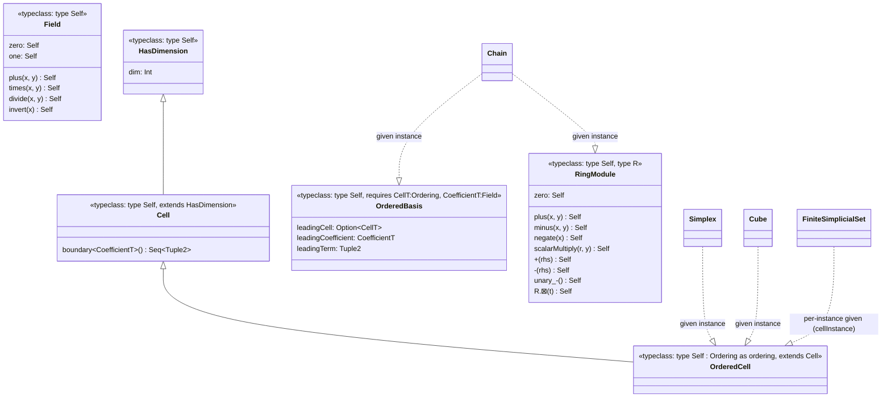

Three concrete `OrderedCell` instances exist: `Simplex[VertexT]`, `Cube`, and a
`FiniteSimplicialSet[G]`'s own generators. The latter is a per-instance `given`
because its boundary depends on that simplicial set's face data.

See the [Scala 3 primer](scala3-primer.md) for the typeclass and `given` syntax.

## `Chain[CellT, CoefficientT]` (`Chain.scala`)

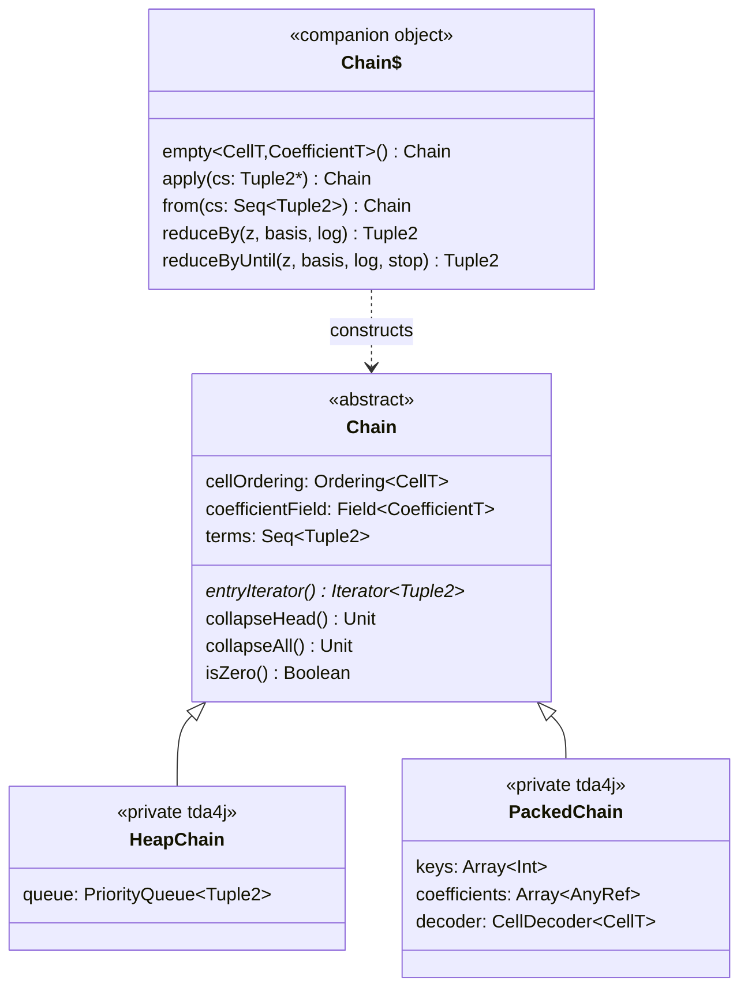

`reduceBy`/`reduceByUntil` are the shared reduction primitives every persistence engine in `Homology.scala`
builds on — see [Architecture](architecture.md) and
[Hard-won invariants #4](gotchas.md).

## `Simplex[VertexT]` (`Simplex.scala`, `SimplexOps.scala`)

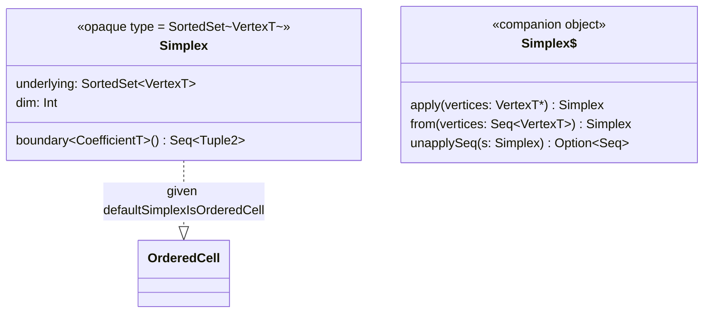

`SimplexOps.scala` adds a large `extension` block delegating most of `SortedSet`'s surface (`.size`,
`.map`, `.union`, `.dropIndex`, ...) so `Simplex` "feels like" a set even though it's a zero-cost opaque
wrapper at runtime — see the [primer](scala3-primer.md).

## Streams (`SimplexStream.scala`, `SimplexIndexing.scala`, `VietorisRips.scala`)

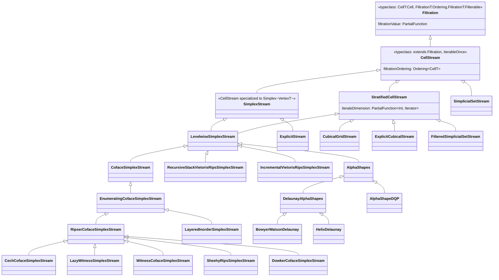

These are **alternate stream implementations with a common output contract, not layers on top of one
another** — see [Architecture](architecture.md). `CubicalGridStream`/`ExplicitCubicalStream` produce
`Cube`s rather than `Simplex`es; `SimplicialSetStream`/`FilteredSimplicialSetStream` produce a
`FiniteSimplicialSet[G]`'s own generator type `G`.

## Persistence engines

Persistence-engine state is deliberately not diagrammed here. See
[Persistence engines](persistence-engines.md) for the current engine hierarchy,
roles, and supported complex types.

## Circular coordinates (`homology/CircularCoordinates.scala`)

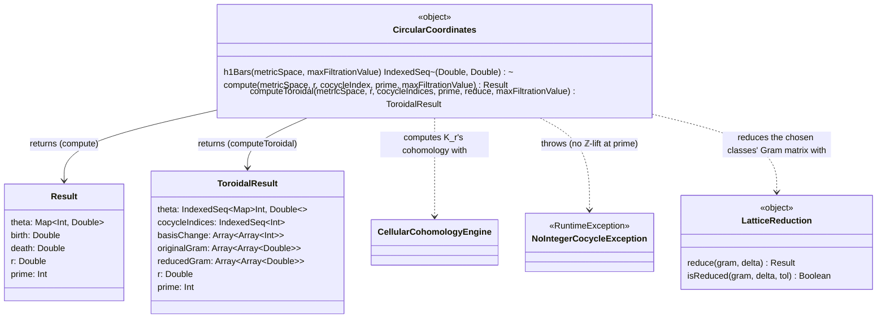

A standalone construction rather than a persistence engine.
`compute` produces circle-valued coordinates from one persistent H¹ class;
`computeToroidal` extends this to several simultaneous classes using
`LatticeReduction`.

## Metric spaces (`FiniteMetricSpace.scala`)

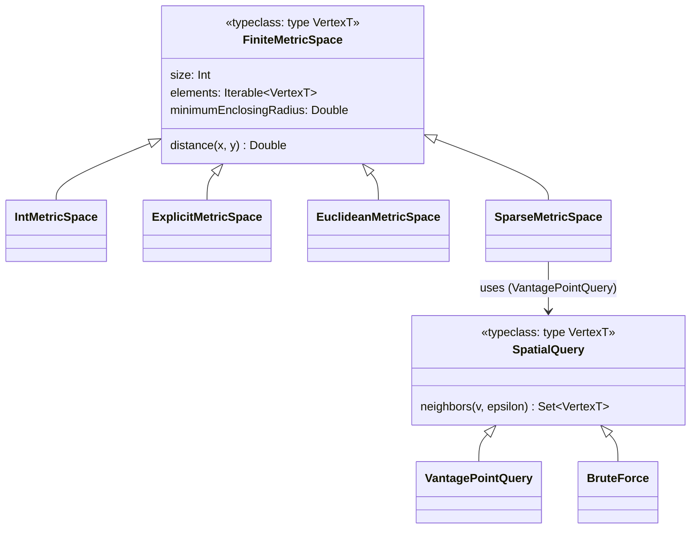

## Barcode representation (`barcode/Barcode.scala`)

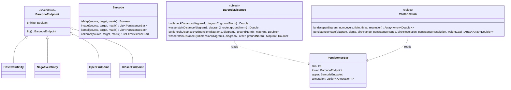
`AnnotationT` is typically a representative `Chain`.
`BarcodeDistance` and `Vectorization` operate only on persistence-bar endpoints
and do not use annotations.

## The public API layer (`homology/Persistence.scala`, `barcode/PersistenceDiagram.scala`, `package.scala`)

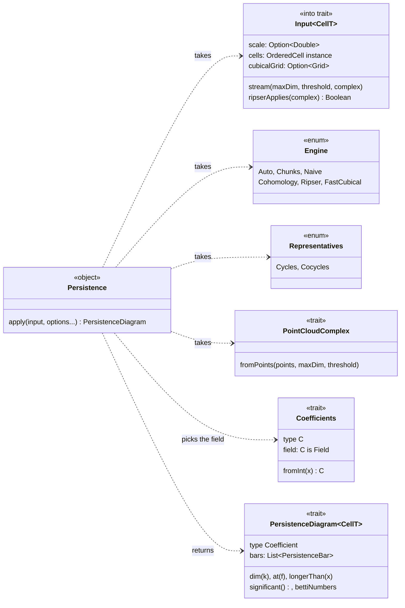

`Input` is an `into` trait: points, metric spaces, images and streams convert
to one at the call site. `Engine` and `Input` are nested in `object
Persistence`. `VietorisRips`, `Cech` and `AlphaShapes` implement
`PointCloudComplex`. See [The public API](public-api.md).

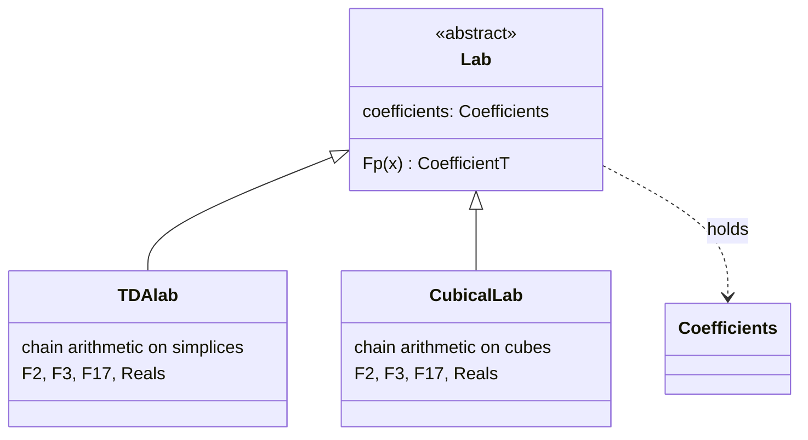

## Nerves and group homology (`sset/`)

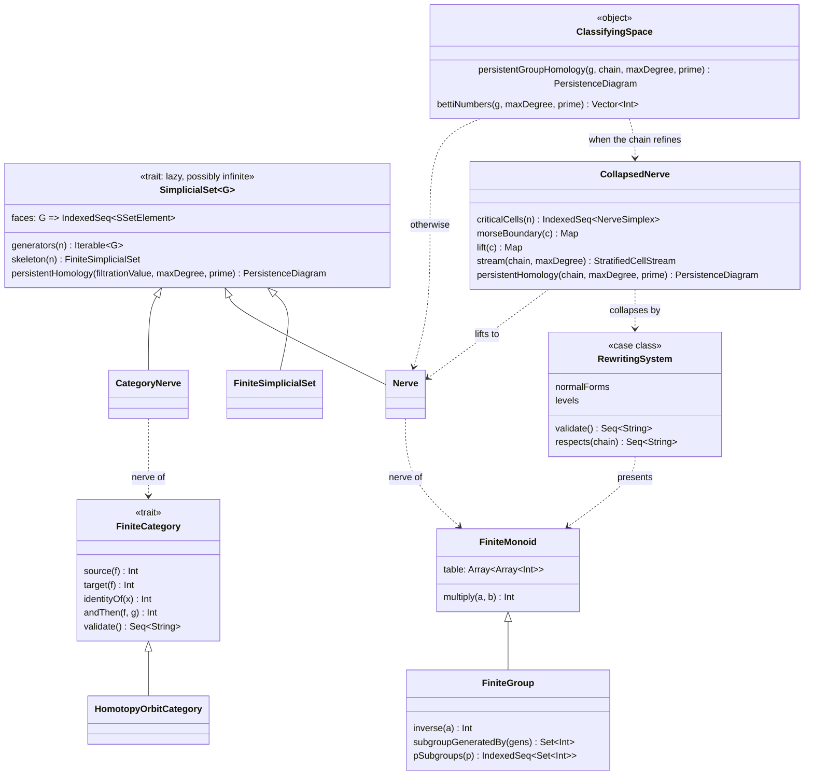

See [Nerves and group homology](nerves.md).

## Plots (`plot/`)

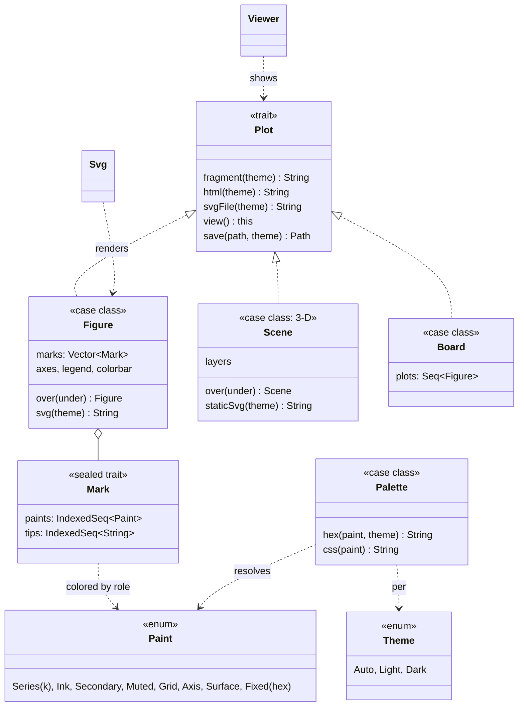

`object Plot` (the TDA constructors: `barcode`, `diagram`, `complex`,
`cycle`, ...) shares the trait's name. See [Plotting internals](plotting.md).
