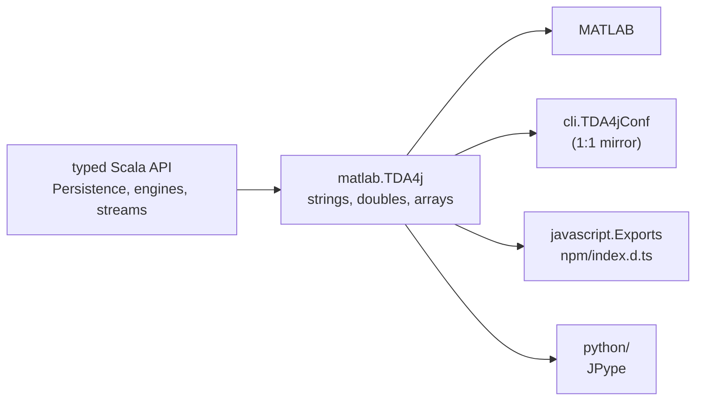

The typed Scala API is the library. Everything else a user can run, MATLAB, the command line, JavaScript and Python,
goes through one class, `org.appliedtopology.tda4j.matlab.TDA4j`, so a new capability is finished only when it
has reached each of them. This page is the path a capability takes, and the traps on it.

## The facade: `matlab.TDA4j`

The facade is Java-facing. A public method **takes only** `double`, `int`, `String` and arrays of them: no `Map`,
generics, `Option` or default arguments. It **returns** those, or a library object MATLAB can call methods on
(`PersistenceResult`, a `plot.Figure`). Options are one flat `String[]` of `key, value, key, value, ...`.

- **Options are parsed once, strictly.** `parseOptionsWithKeys` lower-cases each key and rejects one that is not in the
  method's allowlist, naming the accepted ones. Each entry point has its own set (`recognizedKeys`,
  `witnessFromLandmarksKeys`, `dowkerKeys`, `eulerCurveKeys`, ...): **a new option key goes into every set whose method
  honours it**, and into none that would ignore it, because a silently ignored option is worse than an error.
- **Values become enums before anything runs.** `dispatch` turns `complex`, `engine` and `field` into private
  `ComplexKind`, `EngineKind` and `CoefficientKind` cases, and refuses a combination that does not exist (alpha with
  `engine=ripser`) with a message in user terms. Nothing in a message names a source file or a private class.
- **Public methods are thin.** The `dispatch*` wrappers validate, call the typed API and attach the threshold; the facade
  adds no mathematics. If a computation needs a decision, make it in the typed API where Scala users get it too.
- **Defaults are decided here, once.** The CLI and the Python package omit an option rather than repeat its default.
  The facade's defaults are the ones in the [public API](public-api.md): degrees 0 to 2, cycles, the field with 17 elements,
  zero-length bars dropped, and bars shorter than 1% of the enclosing radius hidden.
- **The result keeps everything.** `PersistenceResult` holds the full arrays and a `visible` index. A distance, a landscape
  or a persistence image is computed from the full barcode, never the filtered one.

## The command line: `cli.TDA4jConf`

Every compute flag mirrors a facade option key, one to one, and has **no Scallop default**: an omitted flag leaves the
key out, and the facade applies its own. `TDA4jCLI` turns the flags back into the string array.

- A new option is `noshort = true`. Scallop gives a short letter to the first declared option that wants it, so a new
  option declared early silently steals a letter users already type; `CLISpec` pins the existing ones.
- Scallop calls `System.exit` on a parse error. A spec must never pass malformed flags to `TDA4jCLI.run`, and a check that
  can fail belongs in `run`, not in a Scallop `validate`.
- A mode that replaces the diagram (`--distance-to`, `--euler-curve`) refuses every flag that would change a diagram.

## JavaScript: `javascript.Exports` and `npm/index.d.ts`

`Exports` (Scala.js only) is a thin layer over the facade: options are an object with the facade's key names, and a Scala
exception becomes a JavaScript `Error` with the same message. The typings are written by hand:
`npm/index.d.ts` lists every option the facade accepts and every exported member. Change both in one commit. The
`npm-package` CI job installs the packed tarball into an empty project and runs it, which catches a broken package but
not a missing typing.

## Python: `python/`

The Python package is a JPype layer over the facade, and it is deliberately small.

- **A new option needs no Python change.** Functions take `**options` in snake_case, and `_jvm.options_in` turns them
  into the camelCase string array. Do not copy the option list into Python signatures.
- **A new facade method needs a wrapper.** `tests/test_facade_coverage.py` lists the public methods of the facade and of
  each result class by reflection, and fails naming any that no Python file calls and that is not in `NOT_WRAPPED` with a
  reason. Add the function to `python/src/tda4j`, or the entry with its reason.
- **A new result class** is wrapped with `translating(Class)`, which turns Java exceptions into Python ones
  (`IllegalArgumentException` into `ValueError`, `UnsupportedOperationException` into `NotImplementedError`).
- **Paths are made absolute in Python** (`_jvm.path_in`). The JVM keeps the directory it started in after `os.chdir`.
- Dataclasses holding NumPy arrays use `eq=False`, since `==` on arrays raises.
- The wheel is tested, not the checkout: the `python-package` job installs it into a clean virtual environment and runs
  the tests from a copy outside the repository. Locally:
  `TDA4J_JAR=<assembly jar> PYTHONPATH=python/src pytest python/tests`.

## Checklist for a new capability

1. The typed API and its specs, with the oracle that its plausible wrong answer fails.
2. The facade method or option, in the right allowlists; a spec in `src/test/.../matlab` that calls `TDA4j` directly,
   not through the test shim `FullBarcode`, which turns the 1% threshold off.
3. The CLI flag, `noshort`, and a `CLISpec` case.
4. `javascript.Exports` if it is a new function, and `npm/index.d.ts` either way.
5. The Python wrapper, if it is a new method.
6. The user guide pages for MATLAB, the CLI and Python, and a tab in the tutorial where the task suits one (see
   [Testing conventions](testing.md#docs-are-tests)).
7. A fragment in `changelog.d/` ([PR workflow](pr-workflow.md)).

What cannot be checked in this repository: MATLAB's own JVM and its marshalling of arrays. The specs call the Java class
directly, so a MATLAB tab in the docs is correct Java and unverified MATLAB.
